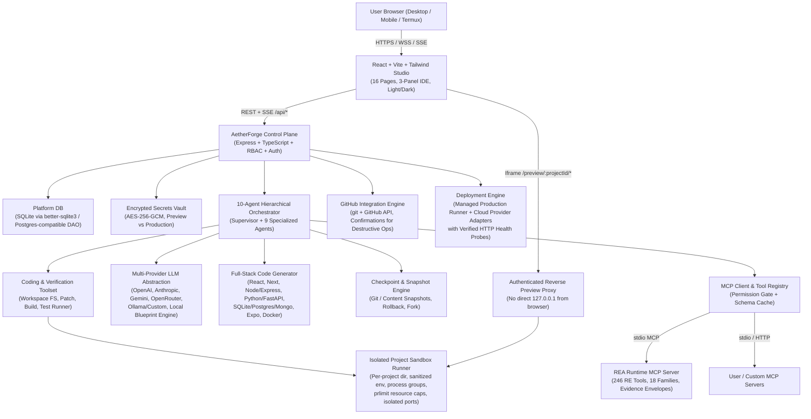

# Phase 3 — System Architecture & Phased Implementation Plan

**Platform Name:** **AetherForge Studio** — Autonomous AI Software Engineering Platform powered by **REA Runtime**  
**Location in Repo:** `/home/user/rea/platform/` (self-contained workspace package preserving `rea-agents` root build, `npm-shrinkwrap.json`, module boundaries, and architecture guards).

---

## 1. High-Level System Architecture



---

## 2. Database Schema (`platform/src/db/schema.ts`)

1. **`users`**: `id`, `email` (unique), `name`, `password_hash` (`scrypt`), `role` (`admin` | `builder`), `theme` (`dark` | `light`), `credits_balance`, `created_at`, `updated_at`.
2. **`sessions`**: `id`, `user_id` (FK), `token_hash`, `expires_at`, `created_at`.
3. **`workspaces`**: `id`, `owner_id` (FK), `name`, `slug`, `created_at`.
4. **`workspace_members`**: `workspace_id`, `user_id`, `role` (`owner` | `admin` | `member` | `viewer`), `created_at`.
5. **`projects`**: `id`, `workspace_id` (FK), `owner_id` (FK), `name`, `slug`, `description`, `app_type` (`fullstack` | `webapp` | `api` | `mobile-expo` | `landing`), `stack_frontend`, `stack_backend`, `stack_database`, `status` (`draft` | `planning` | `building` | `running` | `error`), `autonomy_mode` (`build` | `plan`), `hitl_mode` (`interactive` | `auto`), `active_checkpoint_id`, `forked_from_project_id`, `github_repo`, `github_branch`, `workspace_path`, `created_at`, `updated_at`.
6. **`agent_configs`**: `id`, `user_id`, `agent_role` (`planner` | `uiux` | `frontend` | `backend` | `database` | `integration` | `testing` | `debugging` | `deployment` | `supervisor`), `provider_id`, `model_name`, `system_prompt_override`, `temperature`, `max_iterations`, `enabled`, `updated_at`.
7. **`llm_providers`**: `id`, `user_id`, `provider` (`local-blueprint` | `openai` | `anthropic` | `gemini` | `openrouter` | `openai-compatible`), `label`, `base_url`, `encrypted_api_key`, `key_hint`, `default_model`, `status`, `created_at`, `updated_at`.
8. **`chat_messages`**: `id`, `project_id` (FK), `run_id`, `role` (`user` | `assistant` | `agent` | `system`), `agent_role`, `content`, `attachments_json`, `plan_json`, `plan_status` (`pending` | `approved` | `revised` | `none`), `checkpoint_id`, `created_at`.
9. **`agent_runs`**: `id`, `project_id` (FK), `trigger_message_id`, `mode` (`plan` | `build` | `modify` | `test` | `debug` | `deploy`), `status` (`queued` | `running` | `awaiting_approval` | `completed` | `failed` | `cancelled`), `stop_reason` (`end_turn` | `plan_pending` | `max_iterations` | `insufficient_credits` | `handoff` | `error` | `cancelled`), `iteration_count`, `credits_used`, `started_at`, `ended_at`, `summary`.
10. **`agent_steps`**: `id`, `run_id` (FK), `project_id` (FK), `seq`, `agent_role`, `action`, `tool_name`, `tool_category` (`coding` | `rea` | `mcp` | `testing` | `deploy`), `status` (`running` | `completed` | `failed`), `input_summary`, `output_summary`, `duration_ms`, `created_at`.
11. **`checkpoints`**: `id`, `project_id` (FK), `parent_id`, `run_id`, `message_id`, `label`, `summary`, `git_commit`, `snapshot_path`, `files_count`, `created_at`.
12. **`project_secrets`**: `id`, `project_id` (FK), `environment` (`preview` | `production`), `key_name`, `encrypted_value`, `value_hint`, `updated_by`, `created_at`, `updated_at`.
13. **`mcp_servers`**: `id`, `workspace_id`, `name`, `scope` (`system-rea` | `public` | `private`), `transport` (`stdio` | `http`), `command`, `args_json`, `url`, `encrypted_env_json`, `permission_mode` (`read-only` | `standard` | `restricted`), `status` (`connected` | `disconnected` | `error`), `tools_cache_json`, `last_verified_at`, `created_at`.
14. **`project_integrations`**: `id`, `project_id` (FK), `integration_id`, `category`, `config_json`, `status` (`configured` | `requires_credentials`), `updated_at`.
15. **`deployments`**: `id`, `project_id` (FK), `provider` (`managed-sandbox` | `vercel` | `netlify` | `fly` | `railway` | `render` | `cloudflare` | `docker`), `environment` (`preview` | `production`), `checkpoint_id`, `status` (`building` | `verifying` | `live` | `failed` | `stopped`), `url`, `health_status`, `health_http_code`, `logs_text`, `provider_response_json`, `created_at`, `updated_at`.
16. **`test_runs`**: `id`, `project_id` (FK), `run_id`, `command`, `status` (`passed` | `failed` | `error`), `total`, `passed`, `failed`, `output_text`, `duration_ms`, `created_at`.
17. **`audit_logs`**: `id`, `user_id`, `project_id`, `action`, `target`, `confirmed`, `metadata_json`, `created_at`.

---

## 3. Agent Communication & Orchestration Model

```
User Prompt ──▶ Supervisor Agent (loads Project Memory + Context + Policy)
                    │
        ┌───────────┴───────────┐
        ▼ (Plan mode)           ▼ (Build / Modify mode)
  Planner Agent           Planner Agent (Blueprint DAG)
        │                       │
  Plan Proposal Card     ┌──────┼──────┬──────────┐
  (User approves/edits)  ▼      ▼      ▼          ▼
                       UI/UX  Database Backend  Integration
                         │      │      │          │
                         └──────┴──┬───┴──────────┘
                                   ▼
                             Frontend Agent
                                   │
                                   ▼
                      Sandbox Runner (Install / Build / Boot)
                                   │
                                   ▼
                            Testing Agent (API + UI + Unit tests)
                                   │
                    ┌──────────────┴──────────────┐
                    ▼ (Failures)                  ▼ (All Green)
             Debugging Agent                Checkpoint Saved
             (Diagnostics -> Patch)         & Preview Ready
                    │
                    └───▶ Re-run Testing Agent (bounded retries)
```

- **Structured Message Bus (`AgentMessage`):** `{ messageId, runId, fromAgent, toAgent, intent, payload, artifactsChanged[], timestamp }`.
- **Tool Boundary Separation:**
  - **Coding Tools:** `fs.read`, `fs.write`, `fs.patch`, `fs.list`, `sandbox.exec`, `sandbox.test`, `sandbox.start_preview`, `checkpoint.save`.
  - **Reverse-Engineering Tools (REA MCP):** `rea.inspect_api_contract`, `rea.analyze_javascript_application`, `rea.inspect_web_network_capture`, `rea.environment_build`, `rea.capture_browser_scenario`, etc. — explicitly tagged `tool_category: "rea"`, with Evidence provenance preserved and never conflated with write-capable coding tools.

---

## 4. Tech Stack Justification
- **Backend (`Express 5 + TypeScript + Node 22 ESM`):** Seamless IPC/MCP integration with REA (`@modelcontextprotocol/sdk`), native `node:crypto` (`scrypt`, `aes-256-gcm`), SSE real-time event streaming, WebSocket terminal/log support, and isolated reverse proxy.
- **Database (`better-sqlite3` with repository abstraction):** Zero external daemon required in Debian/Termux/CI sandboxes while preserving normalized relational schema portable to PostgreSQL via `DATABASE_URL` adapter.
- **Frontend (`React 19 + TypeScript + Vite 6 + Tailwind CSS v4 + Lucide`):** Fast build (<3s), mobile/Termux browser compatible, clean dark/light design tokens, zero native SWC constraints, served both in dev (HMR) and production (`dist/client`).
- **Sandbox Execution (`child_process` + process groups + Linux `prlimit` when available):** Separate process tree per project, sanitized env (strictly excluding platform keys), real port assignment, real build & test execution.

---

## 5. Phased Implementation Plan (Phases 4–10)
- **Phase 4 (Foundation):** Bootstrap `platform/` package, SQLite DB + migrations, scrypt auth + multi-tenant RBAC, encrypted secret vault, core Express API, Vite/React shell with light/dark theme & responsive navigation across all 16 routes.
- **Phase 5 (AI Engine & Code Generation):** Multi-provider LLM client (OpenAI, Anthropic, Gemini, OpenRouter, Ollama/Custom, Built-in Local Blueprint Engine), 10 specialized agents + Supervisor orchestrator, SSE live streaming, Plan vs Build gate, multi-stack project templates & generator (React/Vite, Next.js, Express, FastAPI, SQLite/Postgres/Mongo/Supabase, Expo, Docker), checkpoints/rollback/fork.
- **Phase 6 (3-Panel IDE, Sandbox Preview & REA+MCP Integration):** Isolated `SandboxRunner`, reverse preview proxy (`/preview/:projectId/`), 3-panel IDE (Chat/Tasks/Agents | Preview Desktop/Tablet/Mobile + Error Capture Bridge | Explorer/Editor/Terminal/Logs/Problems/DB Viewer/API Tester), `McpManager` bridging live REA MCP server (`246` tools) + custom MCP servers, dedicated REA Workbench & MCP Explorer UI.
- **Phase 7 (Testing, Debugging & GitHub + Marketplace + Deployment):** Real sandbox test runner + self-healing Debugging Agent loop, GitHub integration (connect, list, create, import/clone, branch, commit, push, pull, PR with destructive confirmation modal), Integrations Marketplace, Deployment Engine (Managed Production Sandbox + real cloud adapter interfaces + live HTTP verification + rollback).
- **Phase 8 (16-Page Polish & Mobile/Termux Compatibility):** Complete all 16 UI views, responsive mobile drawer/tab switching, keyboard shortcuts, accessibility & dark/light parity.
- **Phase 9 (Automated Verification & 16-Step E2E Acceptance):** Unit/integration/security tests (`vitest`), plus live server + real end-to-end execution of all 16 acceptance workflow steps with captured HTTP/DB/test/preview/deploy evidence.
- **Phase 10 (Documentation & Final Hygiene):** Complete Installation, Architecture, Environment Setup, and Deployment guides (`platform/docs/`), verify REA's existing build/typecheck/guards remain 100% green, verify no secrets/credentials committed.
