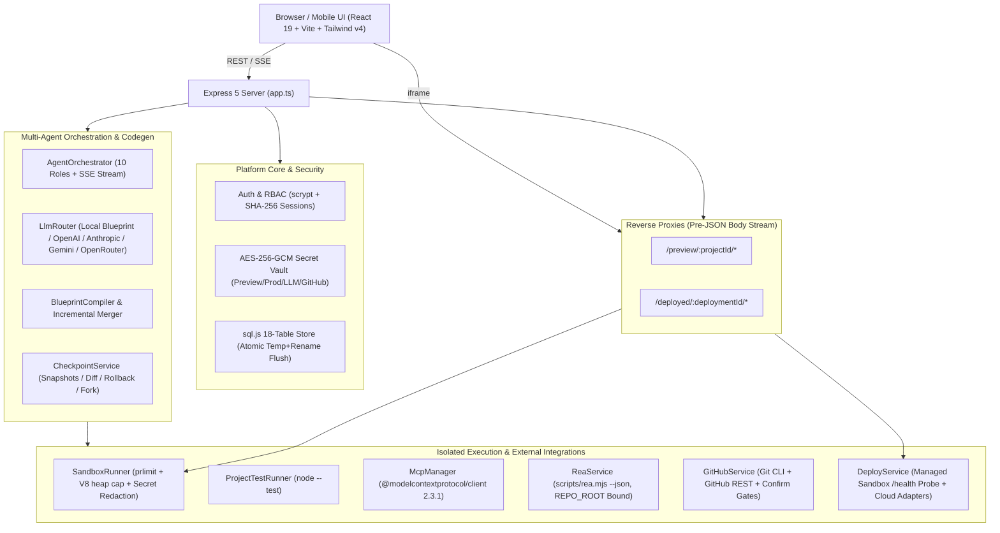

# Architecture Documentation — AetherForge Studio

## 1. High-Level System Architecture

---

## 2. Directory & Layer Ownership

| Path | Responsibility |
| --- | --- |
| `shared/types.ts` | Canonical DTO contracts shared cleanly between server and client |
| `server/config/env.ts` | Directory resolution, port allocation, master key management |
| `server/crypto/security.ts` | `scrypt` passwords, `aes-256-gcm` encryption, path containment, secret redaction |
| `server/db/database.ts`, `seed.ts` | 18-table SQLite schema, atomic persistence, default templates, integrations, agents |
| `server/middleware/auth.ts` | Cookie/Bearer/query token authentication, workspace access & admin RBAC |
| `server/services/llm/*` | Provider adapters and per-agent encrypted key routing |
| `server/services/agents/*` | Multi-agent workflow loop, Zod-validated LLM customization, full-stack synthesis |
| `server/services/sandbox/*` | Subprocess isolation, `node --test` execution, project DB table inspector |
| `server/services/checkpoints/*` | Per-turn snapshots, diff computation, rollback, workspace forking |
| `server/services/mcp/mcpManager.ts` | `stdio` and `StreamableHTTP` MCP client discovery and permission enforcement |
| `server/services/rea/reaService.ts` | Isolated REA reverse-engineering bridge (`scripts/rea.mjs --json`) |
| `server/services/github/githubService.ts` | Local git commit/branch + remote GitHub API with confirmation gates |
| `server/services/deploy/deployService.ts` | Immutable release packaging, `/health` HTTP 200 verification, cloud adapters |
| `server/routes/*` | REST & SSE routers scoped by path so sibling middleware never leaks |
| `client/` | React 19 SPA across 16 routes with responsive 3-panel IDE |

---

## 3. Security & Isolation Guarantees

1. **Path Containment (`resolveContainedPath`):** Canonicalizes workspace roots via `realpathSync`, rejects null bytes, `..` traversal, Windows/Unix absolute paths, and symlinks pointing outside the project directory.
2. **Credential Isolation:** LLM API keys, GitHub tokens, and `preview` / `production` secrets are stored encrypted with AES-256-GCM, masked on reads (`keyHint` / `valueHint`), redacted from runtime logs, and platform keys are never injected into generated app subprocesses.
3. **Reverse Proxy Ordering:** `/preview/:projectId/*` and `/deployed/:deploymentId/*` mount before `express.json()` so `POST`/`PATCH`/`PUT` request streams pass directly to target sandboxes without stream consumption.
4. **REA vs. Coding Separation:** Reverse-engineering tools run strictly inside `/api/rea/*` and the `system-rea` MCP server (`read-only` / `standard` / `restricted` policies), independent of app-generation tools.
5. **Confirmation Gates:** Remote GitHub repo creation, pushes, pull requests, and deployment deletions reject unconfirmed payloads (`confirmDestructive: true` required).
